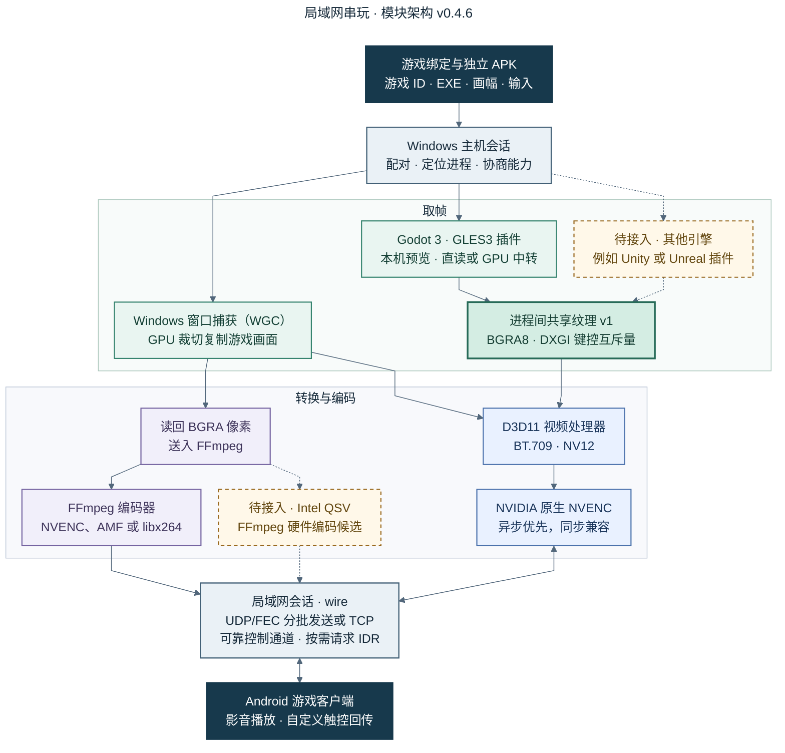

# 串流模块架构

本文对应 v0.4.6 体验版。游戏条目保存 EXE、画幅和输入方式。主机会话按游戏 ID 找到进程，再根据取帧设置、插件和显卡能力选择路径。多款游戏可以复用同一套引擎适配器、编码后端和 Android 播放代码，各自打包专用 APK。实线表示已有实现，虚线表示待接入示例。

## 当前怎样选路

主机启动时用 FFmpeg 试编码三帧，依次尝试 `h264_nvenc`、`h264_amf`、`libx264`，记录第一个成功的编码器。手机连接后，`session` 匹配游戏 ID 和 EXE，协商 UDP 与目标尺寸。`start_video` 根据这些结果选择图中的路径。[编码器探测](../host/src/video.rs) · [会话与选路](../host/src/main.rs)

| 取帧设置 | 实际行为 |
| --- | --- |
| `--capture window`（默认） | 通过 Windows Graphics Capture（WGC）采集目标窗口。探测选中 NVENC 且会话启用低延迟档时，优先用 D3D11 纹理直送。其余情况走窗口像素读回与 FFmpeg。 |
| `--capture auto` | 在原生像素档、UDP 和有效手机目标尺寸下，NVIDIA 直送路径按目标 PID 尝试打开游戏插件。插件缺失或共享纹理协商失败时尝试 WGC。非严格模式下，原生 D3D11 路径启动失败还可回到预选的 FFmpeg 编码器。 |
| `--capture game` | 严格请求游戏内取帧。需要插件、原生像素档、UDP、有效目标尺寸和 NVIDIA NVENC。Godot 插件核对实际写入的颜色附件，能共享时直读，引擎写入私有纹理时通过 GPU 复制交付。缺少前置条件或启动失败时向手机报告原因。 |
| `--capture game-copy` | 使用相同的严格前置条件，强制中转复制，便于在同一场景与直读对照。 |

**显卡支持取决于输入路径。** NVIDIA 已接入 D3D11 纹理、NV12 转色和原生 NVENC，也可以走 FFmpeg NVENC。AMD 已接入窗口像素读回后的 FFmpeg AMF。对于仅有 Intel 显卡的电脑，当前探测链可使用 CPU 的 `libx264`。Intel QSV 和 AMD 原生纹理直送都是后续可扩展项。混合显卡以实际设备、可打开的纹理和试编码结果决定路径。[GPU 设备与帧来源](../host/src/gpu_video.rs) · [转色器](../host/src/color_gpu.rs) · [编码器实现](../host/native/nvenc.cpp)

## 新适配从哪里接入

| 扩展对象 | 接入位置 | 怎样验证 |
| --- | --- | --- |
| **新游戏** | 用 `build-android.ps1` 为 EXE 分配独立 `AppSlug`，按游戏填写 `-Xbox` 和已知的 `-NativeAspect`。普通可捕获的窗口可直接用 WGC。专用布局与按键持久化在 Android 的 `Profile`。 [构建与绑定](../build-android.ps1) · [布局与按键](../android/java/dev/lanstream/mobile/Profile.java) | 自动连接应找到绑定的 EXE。检查菜单操作、断线松键和手机画幅。 |
| **新引擎** | 从引擎能保证最终画面就绪的回调接入。可共享 BGRA8 时对接现有进程间接口，私有渲染目标可先复制到共享纹理。同时保留本机预览。若要引入新的帧表示，在 `FrameInput` 和消费端显式接入。 [Godot 生产端](../render-bridge/godot_bridge.cpp) · [共享约定](../render-bridge/frame_link.h) · [消费端](../host/native/game_texture.cpp) · [FrameInput](../host/src/gpu_video.rs) | 同时核对本机预览和解码画面的颜色、方向与逐帧编号。用严格模式确认实际来源，再对照窗口路径。 |
| **新显卡后端** | FFmpeg 路线从 `Codec` 的参数、探测顺序及三帧试编码接入。原生路线还要适配设备、输入纹理、色彩转换、提交与回收，向 `stream` 交付按序的 H.264 访问单元。当前 Godot 生产端和原生主机均依赖 NVIDIA，扩展其他厂商的游戏内直送时需要同时核对两端互操作能力。 [FFmpeg 路线](../host/src/video.rs) · [原生选路](../host/src/main.rs) · [纹理接收](../host/src/game_texture.rs) | 在目标硬件上验证首个 IDR、BT.709 色彩、帧序、重连和不支持时的回退。 |

进程内插件与主机在同一台电脑上按 PID 通信。共享接口 v1 约定三张 BGRA8 纹理，由生产端和消费端交替取得键控互斥量。主机选取最新可读画面，转色完成后释放纹理。扩大像素格式或更改纹理所有权约定时，应处理接口版本兼容。[进程间协议](../render-bridge/frame_link.h) · [主机资源校验](../host/native/game_texture.cpp)

手机通过 `StreamInfo.encoder` 得知实际路径。当前 `nvenc-game-direct` 和 `nvenc-game-copy` 分别显示为游戏内直读和复制，`nvenc-d3d11` 与 FFmpeg 编码器显示为窗口取帧。引入新的游戏内编码后端时，同步更新主机上报和手机菜单映射，确保实测能分辨选中的后端。视频交给系统 AVC MediaCodec 解码。[网络协议](../wire/src/lib.rs) · [Android 接收](../android/native/src/lib.rs) · [菜单映射](../android/java/dev/lanstream/mobile/MainActivity.java) · [解码与上屏](../android/java/dev/lanstream/mobile/MediaRunner.java)

声音沿独立的通道下行，Windows 通过 WASAPI 采集游戏进程音频，经 TCP 发往 Android 的 AudioTrack。手机将按键或指针回传给目标游戏。Xbox 按钮走可靠连接，协商成功时摇杆走带序号的 UDP 最新状态。[进程音频](../host/src/audio.rs) · [键鼠输入](../host/src/input.rs) · [虚拟手柄](../host/src/gamepad.rs) · [UDP 摇杆](../android/native/src/axes.rs)

## 维护与验收

从 v0.4.7 起，原生 NVENC 主机通过 `StreamInfo.keyframe_feedback` 声明按需关键帧能力。UDP 接收端为乱序包和 FEC 保留恢复时间。有更新的完整帧持续等候 8 毫秒时，可跳过缺帧。确认缺帧或解码队列溢出后，手机通过可靠控制连接请求 IDR，继续播放仍能解码的已排队画面，收到 IDR 时切换到新参考帧。旧主机和 FFmpeg 路径使用周期性关键帧。Android 日志记录恢复次数、最长恢复时间和显示回调的最大间隔。[重组](../wire/src/udp.rs) · [编码](../host/src/gpu_video.rs) · [解码](../android/java/dev/lanstream/mobile/MediaRunner.java)

Windows 发送线程为已连接的 UDP 视频套接字申请 qWAVE 音视频优先级，系统不支持时仍可分批发送。Windows 每批最多发送六个数据报，大帧的分批等待预算上限为 6 毫秒。Android 在前台 UDP 串流期间持有低延迟 Wi-Fi 锁，停止串流时释放。解码队列能容纳短时成批到达的视频，积压时可从更新的 IDR 接续。硬件解码器支持的速率高于显示目标时，可以更快清空积压。[UDP 发送](../host/src/fast_video.rs) · [手机会话](../android/java/dev/lanstream/mobile/MainActivity.java)

本页的 Mermaid 代码是架构图的维护入口。增加游戏绑定字段、引擎生产端、编码后端或回退条件时，在同一次改动中更新受影响的节点、选路说明和代码链接。扩展示例实现后，将对应虚线改成实线，并在本节注明实际测试的引擎、显卡和客户端环境。

v0.4.6 已在 Godot 3.6.1 GLES3、Mod Loader 6.3.0 和 RTX 3050 Ti Laptop GPU 的独立场景验证窗口捕获、游戏内直读及中转复制。Android 11 模拟器验证了解码与显示。Steam 版《土豆兄弟》1.2.0.3 的定制 Godot 3.7 在本机通过 Godot autoload 加载同一份适配脚本，vivo V2307A 在 Wi-Fi 下以 2240×1260 收到 `nvenc-game-copy`，Xbox 菜单导航通过。其他引擎和显卡需单独验证。比较流畅度时，记录物理手机 SurfaceFlinger 的实际上屏间隔，并分别报告电脑编码输出和手机恢复关键帧的耗时。

同一台手机以 60 fps 为目标，在同一暂停画面上各采集约 75 秒。v0.4.6 与 v0.4.7 的实际上屏间隔 P99.9 分别为 265.9 和 149.5 毫秒，超过 200 毫秒的间隔分别出现 8 次和 1 次。v0.4.7 另一次游戏窗口在前台的 75 秒采样仍出现 6 次超过 200 毫秒的间隔。游戏负载和无线条件会影响结果。
